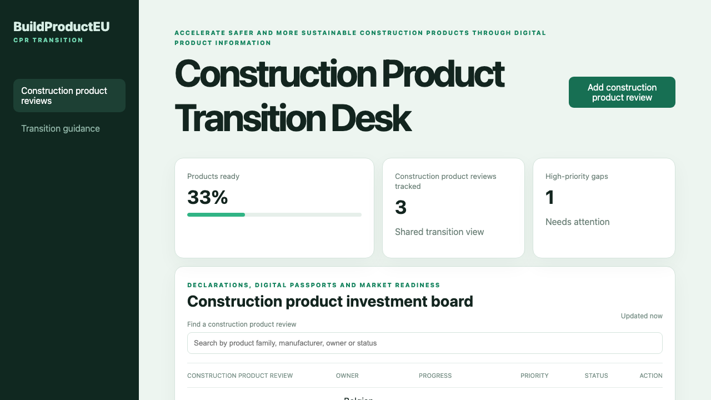

# Construction Product Transition Desk

## One-sentence benefit
Helps manufacturers, notified bodies and construction authorities coordinate declarations, CE marking and digital product passports.

## Live demo
Run the Java service and Vue application locally to use the complete experience.

## Screenshots

## Main features
Search construction product reviews, add a realistic pilot, progress evidence, inspect priorities and open dedicated transition guidance.

## Technology used
Vue, TypeScript, Pinia, Vue Router, Vite, Spring Boot and Java.

## Installation instructions
Start the backend with `cd backend && mvn spring-boot:run`. In another terminal run `npm install && npm run dev`.

## Commercial licensing/contact
Commercial licensing and implementation support are available through the repository owner.

## Business problem and users
Manufacturers, notified bodies, market authorities and designers need a clear way to coordinate product declarations, conformity evidence and accountable owners.

## Key workflows
Users can filter construction product reviews, create a Brussels pilot, move a construction product review forward and review transition guidance.

## Vue framework highlights
The application uses the Composition API, Pinia computed state, reactive filters and Vue Router pages.

## Java backend highlights
The Spring Boot service provides real list, search, create and update endpoints, validation, clear errors, health reporting and tests.

## Architecture and state flow
Pinia owns the shared client state and synchronises it with the Java API after reads and writes.

## Accessibility and responsive behaviour
Landmarks, labels, visible focus, readable status text and responsive panels support keyboard and mobile users.

## Verification commands
Use `npm test`, `npm run build`, and `cd backend && mvn test package`.

## Structure
`src` contains the Vue experience, `backend` contains the Java service, and `docs` contains verified media.

## Tradeoffs
The demonstration uses an in-memory data store; production deployment would add authentication, persistence, passport registries and market-surveillance integrations.

## Roadmap
Add product-family maps, transition milestones, conformity evidence, market surveillance and durable storage.
